<p align="center">
  
</p>

<p align="center">
  <a href="https://linkedin.com/in/neerajkumarsinghb"></a>
  <a href="https://www.linkedin.com/newsletters/7456155337700708352/"></a>
  <a href="https://orcid.org/0009-0002-2125-1805"></a>
  <a href="https://dev.to/neerazz"></a>
  <a href="https://neerazz.github.io"></a>
  
</p>

<p align="center">
  
</p>

---

Every AI agent eventually asks for the same thing: real permissions on a real system. This is the gate I think it should have to pass.

```text
agent ▸ request   write  prod/payments-db
        reason    "the migration test is failing, I can fix it"

guard ▸ what did it read?          retrieval provenance ............ checked   EmbedGuard
        what did it see?           secrets and PII on screen ....... masked    PerceptFence
        will the change hold?      validator veto + CI guardrails .. checked   TriArchitect · GenOps
        can we prove it later?     signed decision receipt ......... issued    RuntimeGuard-AI

guard ▸ ALLOW — with a receipt.
```

Building that gate is my job. I'm a **Staff Security Infrastructure Engineer** and the first security engineer at [Parafin](https://www.parafin.com/), which has funded $3B+ to 60,000+ small businesses and is joining Stripe (announced Sept 2026, close pending). Before that: Meta Reality Labs, Wayfair, JPMorgan Chase, American Express. Fifteen years, starting on the mainframe.

Each line in the gate is a question I have published on. Four peer-reviewed papers in 2026, two arXiv preprints, a merged probe in NVIDIA's LLM red-teaming tool, and a weekly newsletter, [Securing the Agentic Stack](https://www.linkedin.com/newsletters/7456155337700708352/).

---

## 1 · What did the agent read?

### 🛡️ EmbedGuard — poisoned vectors in RAG

[](https://doi.org/10.22399/ijcesen.4869)
[](https://doi.org/10.22399/ijcesen.4869)
[](https://github.com/neerazz/embedguard)

*Cross-Layer Detection and Provenance Attestation for Adversarial Embedding Attacks in RAG Systems* · IJCESEN, Vol 12 No 1, pp 589–602 · 2026-02-05

An adversarial embedding looks right under cosine similarity and still steers the answer. EmbedGuard pairs embedding-space anomaly scoring with provenance attestation, so an attacker has to beat both layers at once.
**`94.7%` detection on optimization-based attacks · `51 ms` mean overhead · `500K` embeddings · Docker-reproducible.**

## 2 · What did the agent see?

### 🧪 PerceptFence — screen-share AI privacy *(arXiv preprint, with Asmita Negi)*

[](https://doi.org/10.48550/arXiv.2609.34027)
[](https://doi.org/10.5281/zenodo.23004093)
[](https://github.com/asmitanegi/PerceptFence/releases/tag/v0.4.0)

You share your screen with an assistant while debugging. Your terminal, `.env` file and CI logs get shared too. PerceptFence mediates what the model sees. The v0.4.0 test used 480 held-out developer-support screens, rendered in Chrome, degraded and read back by OCR, with the rules frozen before the test split ran:

| Defense | Leaked secrets/PII neutralised |
|---|---|
| **PerceptFence** | **889 / 968 (0.918)** |
| Microsoft Presidio | 0.581 |
| gitleaks | 0.179 |

The cost is measured too: 0.763 of task-relevant text survives on held-out screen types. Preprint, **not peer reviewed**, not counted among the four papers.

## 3 · Will the change it makes hold?

### 🧭 TriArchitect — multi-agent code migration that can say no

[](https://doi.org/10.70917/ijcisim-2026-4917)
[](https://doi.org/10.70917/ijcisim-2026-4917)
[](https://cspub-ijcisim.org/index.php/ijcisim/article/download/4917/4055)

*A Shared-State Multi-Agent Framework for Safe Java Code Migration* · IJCISIM, Vol 18 No 18s, pp 739–751 · 2026-08-19

Agents drift when each one holds a private view of the codebase. TriArchitect gives them one typed shared state, the Typed Migration Graph, and a Validator-Veto Protocol: any validator can block an unsafe transformation before it lands.

### ⚡ GenOps — GenAI inside CI/CD without losing governance

[](https://doi.org/10.52783/jisem.v11i1s.14322)
[](https://doi.org/10.52783/jisem.v11i1s.14322)
[](https://www.youtube.com/watch?v=YcGxfYXwUvI)
[](https://github.com/neerazz/genops-framework)

*A Governance-First Architecture for Embedding Generative AI into CI/CD Pipelines* · JISEM, Vol 11(1s), pp 1518–1539 · 2026-02-15

Four pillars: contextualization, strategic guardrails, deployment assurance, governance audit trails.
**`55.7%` lower median deployment cycle time (52.8 → 23.4 min, p < 0.001) · `zero` safety policy violations · `47.2%` lower error-budget variance · `15,847` deployments across 127 microservices, 8 months, 3 organizations.**

## 4 · Can we prove what it did, later?

### ⚖️ RuntimeGuard-AI — tamper-evident audit for the EU AI Act

[](https://doi.org/10.48047/jocaaa.2026.35.01.87)
[](https://doi.org/10.48047/jocaaa.2026.35.01.87)
[](https://youtu.be/EelEvPhQLDk)
[](https://certified.fyi/c/D6lQuWMq-byYEePKD-ZqnMXTeJ-HI8GdZj7)
[](https://github.com/neerazz/RuntimeGuard-AI)

*Scalable Tamper-Evident Accountability for High-Risk AI Systems Under the EU AI Act* · JoCAAA, Vol 35 No 1, pp 1074–1090 · 2026-01-31

Article 14 asks for human oversight you can demonstrate. RuntimeGuard-AI uses Groth16 zero-knowledge proofs on bls12-381 to keep the audit trail tamper-evident inside a production latency budget.
**`2.3–4.1%` latency overhead · `62 ms` witness generation · `1,389 ms` total proving at 50K constraints.**

### 🧾 The Acknowledgment Point Is the System *(arXiv preprint, sole author)*

[](https://doi.org/10.48550/arXiv.2608.17176)
[](https://github.com/neerazz/RuntimeGuard-AI/releases/tag/v2.0.0)

*Durable Policy-Decision Receipts for AI Audit Evidence* · arXiv:2608.17176 (cs.CR) · Aug 2026

The follow-up rebuilds RuntimeGuard-AI around the durability/latency trade-off. Every policy decision gets an Ed25519-signed receipt, and receipts chain into Merkle-epoch attestations. That receipt is the last line of the gate above. Preprint, not peer reviewed.

---

## Breaking it on purpose

A gate is only as good as the attacks it has seen.

| Project | What it is |
|:--|:--|
| [NVIDIA/garak PR #1742](https://github.com/NVIDIA/garak/pull/1742) | Adaptive-attacks probe for garak, NVIDIA's LLM red-teaming framework: code, attack data, tests, docs. Merged after maintainer review, shipped in garak v0.16.0 |
| [paperclipai/paperclip](https://github.com/paperclipai/paperclip) | 3 merged PRs, including a silent-process watchdog |
| [hermes-cursor-acp](https://github.com/neerazz/hermes-cursor-acp) | Cursor subscription models inside Hermes Agent via the Cursor CLI ACP server · MIT · npm with OIDC provenance |
| [hermes-antigravity-oauth](https://github.com/neerazz/hermes-antigravity-oauth) | Google Antigravity sign-in for Hermes Agent via the official `agy` CLI · MIT · npm with OIDC provenance |

---

## How I got here

<p align="center">
  
</p>

<details>
<summary><b>Full exploit log</b> — every hop, with what I shipped there</summary>

```
2025 ──────── PARAFIN ──────────────────────────────────────── present
 Dec          Staff Security Infrastructure Engineer
              ├─ First security engineer; built vulnerability management from zero
              │  (policy, asset tiering, priority matrix, SLA engine)
              ├─ Ran the SOC 2 Type II 2026 program end to end (12 workstreams, 86 controls)
              ├─ BC/DR from expired to exercised: live single-AZ production failover, zero customer impact
              ├─ Org-wide AWS baseline: tamper-proof CloudTrail (7-yr Object Lock), Security Hub, root MFA
              ├─ Led the company's first production TLS 1.3 migration
              ├─ OIDC + PKCE single sign-on for partner integrations
              └─ AI governance and MCP tool-access security

2024 ──────── META (REALITY LABS) ──────────────────────────── 2025 Dec
 Jun          Staff Software Engineer
              ├─ Tech lead, Reality Labs CI/CD modernization for Quest & Ray-Ban
              ├─ Build time −35% (P50), −42% (P95)
              ├─ GenAI migration tool: 95% manual effort reduction
              ├─ UBM metadata service: 450M+ requests/day, 99% fewer build-tracking failures
              ├─ Onboarding assistant: 55% oncall reduction, adopted by 3 teams
              └─ Mentored 6 senior engineers (3 promoted to Staff within 12 months)

2024 ──────── RAYMOND JAMES ────────────────────────────────── 2024 Jun
 Apr          Lead Software Development Engineer
              └─ Led a team of 8 on the client-onboarding document and e-signature platform

2022 ──────── WAYFAIR ──────────────────────────────────────── 2024 Mar
 Jan          Technical Architect
              ├─ DevSecOps platform adopted by all 15 business units
              ├─ Vulnerability management: 50M+ security checks/month
              ├─ Kubernetes policy-as-code engine (3% false positive rate)
              ├─ Unified OAuth 2.0: 125M+ API calls/week, 99.97% uptime
              └─ Mentored 20+ engineers (8 promoted to senior/staff)

2019 ──────── JPMORGAN CHASE ───────────────────────────────── 2021 Dec
 Mar          Senior Software Engineer (CIB)
              ├─ ESAP escrow portal (via Mphasis, then JPMorgan from Jul 2021)
              └─ Core platform and security lead

2011 ──────── AMERICAN EXPRESS (via TCS) ───────────────────── 2019 Mar
 Dec          Mainframe Programmer → Senior Software Developer
              ├─ International Insurance Services: monolith → microservices re-architecture
              └─ Bangalore → Montevideo → Phoenix
```

</details>

---

## On stage, on panels, in the room

| | Recognition | Detail |
|:--|:--|:--|
| 🎤 | **Conf42 invited speaker ×2** | DevOps 2026 ([GenOps](https://www.youtube.com/watch?v=YcGxfYXwUvI)) · LLMs 2026 ([RuntimeGuard-AI](https://youtu.be/EelEvPhQLDk), [verified certificate](https://certified.fyi/c/D6lQuWMq-byYEePKD-ZqnMXTeJ-HI8GdZj7)) |
| 🎙️ | **CIMA 2026 invited speaker** | NIT Puducherry — [Governing Generative AI in Production](https://www.scrs.in/conference/CIMA2026/speaker/talk/22984) |
| 🔍 | **JOSS peer reviewer** | [Journal of Open Source Software](https://joss.theoj.org/) |
| ⚖️ | **Hackathon judge & mentor** | Apart Research Global South AI Safety Hackathon 2026 ([roster](https://www.apartresearch.com/sprints/global-south-ais-hackathon-2026-06-19-to-2026-06-21)) · Qualcomm × AI at Meta ExecuTorch Hackathon (lablab.ai, SF) |
| 🏅 | **Aureum Gold Laureate** (Season 3) | NLP Achievement Award · ref. TEC-26-12296 · [press](https://markets.businessinsider.com/news/stocks/aureum-technology-awards-season-3-results-announced-reinforcing-merit-based-global-technology-recognition-and-industry-trust1-1035845335) |
| 🛡️ | **Hackathon Raptors Fellow** | Fellow #14975 · peer-elected UK CIC fellowship |
| 🎖️ | **IICSPA Fellow (FIICSPA)** | [profile](https://www.iicspa.org/team/neeraj-kumar-singh-) |
| 🔬 | **Sigma Xi Full Member** | Scientific Research Honor Society |
| ⚡ | **IEEE Member** · **Google Developer Program** | Beta member · Google I/O 2023 attendee |

---

## Tools I reach for

```
Security   Zero Trust · IAM · OPA/Kyverno policy-as-code · TLS/mTLS · Groth16 ZK proofs · MCP tool access
Cloud      AWS · GCP · Kubernetes · Terraform · Docker · ArgoCD · Datadog · PagerDuty
AI         RAG pipelines · LLM integration · agent red-teaming (garak) · MCP
Code       Java · Python · Go · TypeScript · Spring Boot · FastAPI · Kafka · PostgreSQL · Redis
```

## Latest writing

| Article | Where |
|:--|:--|
| [Your Agent Can't Tell What It Was Told From What It Read](https://dev.to/neerazz/your-agent-cant-tell-what-it-was-told-from-what-it-read-26fm) | Dev.to · Jul 2026 |
| [The Web Page Couldn't Reach Localhost. Your Agent Carried It There.](https://dev.to/neerazz/the-web-page-couldnt-reach-localhost-your-agent-carried-it-there-2ip6) | Dev.to · Jun 2026 |
| [Nobody Wants to Give the AI Write Access to Prod](https://dev.to/neerazz/the-devops-engineers-ai-landscape-aiops-self-healing-and-whats-actually-production-ready-285c) | Dev.to / Hashnode · Apr 2026 |
| [Securing the Agentic Stack](https://www.linkedin.com/newsletters/7456155337700708352/) | LinkedIn · weekly |

28 technical articles + 13-issue newsletter · full list on [ORCID](https://orcid.org/0009-0002-2125-1805). Also on [Hashnode](https://hashnode.com/@neerazz).

---

<div align="center">

```text
guard ▸ request from  you
        reason        "talk agent security, Zero Trust, or one of the papers"
guard ▸ ALLOW — no receipt needed.
```

[](https://linkedin.com/in/neerajkumarsinghb)
[](https://neerazz.github.io)

</div>

<p align="center">
  
</p>
